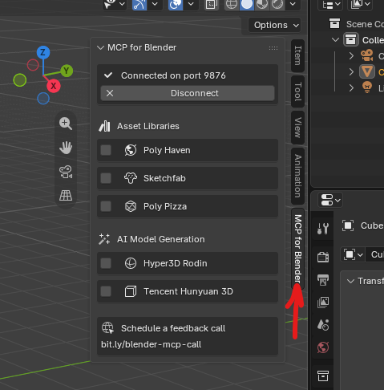

# Claude / Codex + Unity + Blender MCP

**English** | [Русский](#русский)

A short step-by-step guide on connecting an AI agent (Claude Code or Codex) to a game engine project and to Blender through MCP, so the agent can build 3D models itself. Shown on a Unity project, but it works the same with Godot, Unreal Engine or any other engine.

PDF: [Blender_MCP_Guide_EN.pdf](Blender_MCP_Guide_EN.pdf) · [Blender_MCP_Guide_RU.pdf](Blender_MCP_Guide_RU.pdf)

*One project, one Blender file, one port.*

### 1. Create a project in your engine
- Create a new project in Unity (or any other engine). Everything in this guide is shown on a single project.

### 2. Open the project folder in Claude or Codex
- Open the root folder of the project in Claude Code or Codex.
- If you use VS Code, open the same folder as the project's workspace folder.

### 3. Create a Blender file inside the project
- Open Blender and create a new file.
- Save it right inside the project folder, for example: `Blender/main.blend`.
- From now on, use only this one file, `main.blend`.

### 4. Install Blender MCP and open the MCP tab
- First install the MCP for Blender add-on. Run in a terminal: `uvx mcp-for-blender install-addon`
- Then in Blender open **Edit → Preferences → Add-ons** and enable “Interface: MCP for Blender”.
- After that, press **N** in the 3D View and open the “MCP for Blender” tab.



### 5. Set the port in Blender
- In the MCP for Blender tab, set the port. This example uses **9876**.
- Start the MCP Server / make sure the server is running.

### 6. Connect Blender MCP to Claude or Codex
Use only the option for the client you work in.

**Claude Code — Desktop or VS Code.** Open a terminal in the project folder and run:

```bash
claude mcp add --scope local blender -- uvx mcp-for-blender --port 9876
```

- Check the connection: `claude mcp list`, or the `/mcp` command inside Claude Code.
- Claude Code Desktop and Claude Code in VS Code both use this project configuration.

**Codex — Desktop or VS Code.** Open a terminal and run:

```bash
codex mcp add blender -- uvx mcp-for-blender --port 9876
```

- Check the connection: `codex mcp list`.
- Codex Desktop and the Codex extension for VS Code share the same MCP configuration.

### 7. Close the engine, keep Blender open
- Save the project and close Unity.
- Keep Blender open with `main.blend` loaded.
- The MCP Server in Blender must keep running on port 9876.

### 8. In your first prompt, name the engine, the Blender file and the port
- Tell the agent it is working with the current Unity project.
- Say that 3D models must be created and edited through Blender MCP.
- Give the Blender file name `main.blend` and port 9876.

Example prompt:

```text
Work with the current Unity project.
Use Blender via MCP to create and edit 3D models.
Blender file: Blender/main.blend
Blender MCP port: 9876
Save all created models and required files inside the current project.
```

---

## Русский

Короткий пошаговый гайд: как подключить ИИ-агента (Claude Code или Codex) к проекту на движке и к Blender через MCP, чтобы агент сам делал 3D-модели. Показано на Unity, но так же работает с Godot, Unreal Engine и другими движками.

*Один проект, один Blender-файл, один порт.*

### 1. Создайте проект в движке
- Создайте новый проект в Unity (либо на другом движке). В этом гайде всё показывается на одном проекте.

### 2. Откройте папку проекта в Claude или Codex
- Откройте корневую папку проекта в Claude Code или Codex.
- Если используете VS Code, откройте эту же папку как рабочую папку проекта.

### 3. Создайте Blender-файл внутри проекта
- Откройте Blender и создайте новый файл.
- Сохраните его прямо внутри папки проекта, например: `Blender/main.blend`.
- Дальше используем только этот один файл `main.blend`.

### 4. Установите Blender MCP и откройте вкладку MCP
- Сначала установите аддон MCP for Blender. В терминале выполните: `uvx mcp-for-blender install-addon`
- Затем в Blender откройте **Edit → Preferences → Add-ons** и включите “Interface: MCP for Blender”.
- После этого в 3D View нажмите **N** и откройте вкладку “MCP for Blender”.

### 5. Укажите порт в Blender
- Во вкладке MCP for Blender укажите порт. Для этого примера используем **9876**.
- Запустите MCP Server / убедитесь, что сервер активен.

### 6. Подключите Blender MCP к Claude или Codex
Используйте только вариант для того клиента, в котором вы работаете.

**Claude Code — Desktop или VS Code.** Откройте терминал в папке проекта и выполните:

```bash
claude mcp add --scope local blender -- uvx mcp-for-blender --port 9876
```

- Проверка подключения: `claude mcp list` или команда `/mcp` внутри Claude Code.
- Claude Code Desktop и Claude Code в VS Code используют эту конфигурацию проекта.

**Codex — Desktop или VS Code.** Откройте терминал и выполните:

```bash
codex mcp add blender -- uvx mcp-for-blender --port 9876
```

- Проверка подключения: `codex mcp list`.
- Codex Desktop и расширение Codex для VS Code используют общую MCP-конфигурацию.

### 7. Закройте движок, Blender оставьте открытым
- Сохраните проект и закройте Unity.
- Blender с файлом `main.blend` оставьте открытым.
- MCP Server в Blender должен оставаться запущенным на порту 9876.

### 8. В первом промпте укажите движок, Blender-файл и порт
- Скажите агенту, что он работает с текущим Unity-проектом.
- Укажите, что 3D-модели нужно создавать и редактировать через Blender MCP.
- Укажите имя Blender-файла `main.blend` и порт 9876.

Пример промпта:

```text
Работай с текущим Unity-проектом.
Для создания и редактирования 3D-моделей используй Blender через MCP.
Blender-файл: Blender/main.blend
Порт Blender MCP: 9876
Все созданные модели и нужные файлы сохраняй внутри текущего проекта.
```
